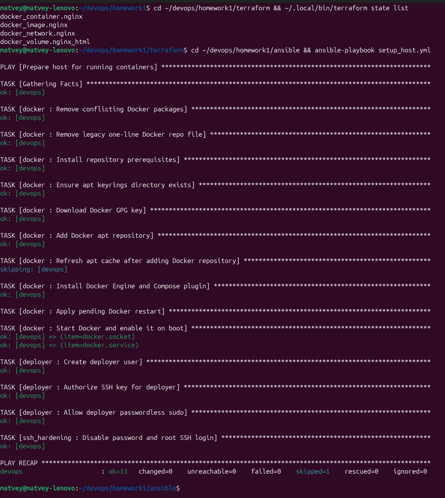

# devops_homework — ДЗ #1 «Фундамент DevOps-инфраструктуры»

Подготовка «чистого» хоста под контейнеры: Ansible настраивает VM в MWS Cloud,
Terraform (провайдер `kreuzwerker/docker`) поднимает nginx в отдельной сети с томом,
Docker Compose разворачивает связку reverse proxy + app, `monitor.sh` проверяет сервисы.

Порядок выполнения изменён по дополнению преподавателя: **сначала Ansible (этап 3), потом Terraform (этап 2)**.

## Архитектура

```
 ноутбук                                    VM 111.88.162.125 (MWS, Ubuntu 24.04)
 ────────                                   ──────────────────────────────────────────────
 ansible-playbook ──ssh student──────────►  setup_host.yml: docker-ce, deployer, sshd hardening
 ansible-playbook ──ssh student──────────►  deploy_app.yml: /opt/app + docker compose up
 terraform ────────ssh deployer─► docker ─► tf-nginx-net 172.30.0.0/24
                                              └─ tf-nginx  :8080 → 80   [volume tf-nginx-html]
                                            app-net 172.31.0.0/24
 curl :80  ───────────────────────────────►   ├─ app-nginx-1 (reverse proxy) :80 → 80
                                              └─ app-app-1   (Hello World, без опубликованных портов)
```

Сети Terraform и Compose разные, контейнеры из них друг друга не видят.

## Структура

```
ansible/
  ansible.cfg, inventory.ini, requirements.yml, group_vars/all.yml
  setup_host.yml          # этап 3: роли docker → deployer → ssh_hardening
  deploy_app.yml          # этап 5: роль app
  roles/{docker,deployer,ssh_hardening,app}/
terraform/
  main.tf variables.tf outputs.tf terraform.tfvars.example files/index.html
scripts/monitor.sh        # этап 4
compose/                  # этап 5: docker-compose.yml, nginx/default.conf, app/index.html
docs/                     # сохранённые выводы команд (доказательства для проверки)
```

## Требования

На машине, откуда запускается всё:

- `ansible-core` ≥ 2.15 и коллекции: `ansible-galaxy collection install -r ansible/requirements.yml`;
- Terraform ≥ 1.6 (проверено на 1.16.5);
- SSH-ключ, который уже лежит в `authorized_keys` пользователя `student` на VM (у нас `~/.ssh/ansible_key`).

Docker локально не нужен: Terraform ходит в Docker на VM по SSH.

## Развёртывание

```bash
# 1. Хост: Docker CE, пользователь deployer, SSH только по ключу
cd ansible
ansible-galaxy collection install -r requirements.yml
ansible-playbook setup_host.yml --check --diff   # посмотреть, что изменится
ansible-playbook setup_host.yml
ansible-playbook setup_host.yml                  # второй прогон: changed=0

# 2. Terraform: nginx в своей сети с томом на порту 8080
cd ../terraform
cp terraform.tfvars.example terraform.tfvars     # указать vm_host
terraform init
terraform plan
terraform apply
curl -i http://<VM_IP>:8080                      # 200 OK

# 3. Compose-стек в /opt/app
cd ../ansible
ansible-playbook deploy_app.yml
curl -i http://<VM_IP>                           # 200 OK, Hello World

# 4. Мониторинг
../scripts/monitor.sh docker                     # локально
ssh devops 'bash -s -- docker' < ../scripts/monitor.sh   # на VM без копирования
```

Удалить ресурсы Terraform: `terraform destroy`. Остановить стек: `ssh devops 'cd /opt/app && docker compose down'`.

## Результаты

### `terraform state list` и повторный прогон Ansible (идемпотентность)



### Terraform: `curl -i` на нестандартный порт

```
$ curl -i http://111.88.162.125:8080
HTTP/1.1 200 OK
Server: nginx/1.27.5
Content-Type: text/html
Content-Length: 212

<h1>Hello from Terraform</h1>
<p>nginx in its own Docker network, content served from a Docker volume.</p>
```

### monitor.sh

Запуск на VM: активный сервис, остановленный сервис (nginx хоста, выключен `deploy_app.yml`) и несуществующий unit.

```
$ ./scripts/monitor.sh docker

== Service: docker.service ==
Status: active

== Errors in /var/log/syslog for the last 60 min ==
Total: 71
Top sources:
      44  dockerd
      15  systemd
      12  containerd

$ ./scripts/monitor.sh nginx

== Service: nginx.service ==
Status: inactive

== Last 10 log lines (journalctl -u nginx.service) ==
...
Oct 14 21:24:53 zhikharevma systemd[1]: Stopping nginx.service - A high performance web server and a reverse proxy server...
Oct 14 21:24:53 zhikharevma systemd[1]: nginx.service: Deactivated successfully.
Oct 14 21:24:53 zhikharevma systemd[1]: Stopped nginx.service - A high performance web server and a reverse proxy server.

== Errors in /var/log/syslog for the last 60 min ==
Total: 71
...
[exit=1]

$ ./scripts/monitor.sh nosuchsvc

== Service: nosuchsvc.service ==
NOT FOUND: unit nosuchsvc.service does not exist on zhikharevma
[exit=3]
```

### Docker Compose: `docker compose ps` и `curl`

```
$ docker compose ps   # в /opt/app
NAME          IMAGE               SERVICE   STATUS                        PORTS
app-app-1     nginx:1.27-alpine   app       Up About a minute (healthy)   80/tcp
app-nginx-1   nginx:1.27-alpine   nginx     Up About a minute (healthy)   0.0.0.0:80->80/tcp, [::]:80->80/tcp

$ curl -i http://111.88.162.125
HTTP/1.1 200 OK
Server: nginx/1.27.5
Content-Type: text/html
Content-Length: 197

<h1>Hello World</h1>
<p>Served by the app container through the nginx reverse proxy.</p>
```

### Полные выводы

Без сокращений все выводы лежат в [docs/](docs/):

| Что | Файл с выводом |
|---|---|
| `terraform state list`, повторный `plan` → No changes | [docs/terraform/state.txt](docs/terraform/state.txt) |
| `curl -i http://<IP>:8080` → 200 OK | [docs/terraform/curl.txt](docs/terraform/curl.txt) |
| Ansible, все прогоны `setup_host.yml`, включая сбой и исправление | [docs/ansible/](docs/ansible/) |
| Ansible, второй прогон `deploy_app.yml` → `changed=0` | [docs/ansible/06-deploy-app-idempotency-run.log](docs/ansible/06-deploy-app-idempotency-run.log) |
| `monitor.sh` на VM (active / inactive / not found / нет прав) | [docs/monitor/vm.txt](docs/monitor/vm.txt) |
| `monitor.sh` локально | [docs/monitor/local.txt](docs/monitor/local.txt) |
| `docker compose ps` и `curl -i http://<IP>` | [docs/compose/ps-and-curl.txt](docs/compose/ps-and-curl.txt) |

## Архитектурные решения

**Terraform через провайдер Docker, а не облачный.** Так требует дополнение к заданию. VM выдана курсом, поэтому
Terraform управляет объектами Docker на ней: сеть (`docker_network` с явной подсетью), том (`docker_volume`),
образ с фиксированным тегом и контейнер с healthcheck. Провайдер подключается по `ssh://deployer@…`:
порт Docker API наружу не открывается, а host key проверяется (`StrictHostKeyChecking=yes`).
State хранится локально и в git не попадает (`.gitignore`): в нём могут быть секреты.
Lock-файл провайдера закоммичен, чтобы `init` везде ставил одну и ту же версию (4.6.0).

**Docker из официального репозитория.** На VM изначально стояла смесь пакетов: `docker.io` из Ubuntu и compose-plugin
из репозитория Docker. Роль `docker` делает то, что описано в документации Docker: удаляет конфликтующие пакеты,
кладёт GPG-ключ в `/etc/apt/keyrings`, подключает репозиторий в формате deb822 и ставит `docker-ce`.
Ключ проверяется по sha256, поэтому подменённый ключ уронит прогон, а не будет молча принят.

**Пользователь `deployer`.** Это отдельная учётка для автоматизации (Terraform, деплой), отдельная от человека (`student`):
понятный аудит, ключ можно отозвать, не трогая свой доступ. Пароля нет, вход только по ключу.
Он в группе `docker`, потому что Terraform обращается к `/var/run/docker.sock` без sudo.
Файл sudoers записывается только после проверки `visudo -cf`.

Честно о наименьших привилегиях: `NOPASSWD:ALL` и группа `docker` фактически дают root
(через `docker run -v /:/host`). Этого требует задание. Строже было бы sudo только на конкретные команды
или rootless Docker; для учебного стенда мы от этого сознательно отказались.

**SSH hardening (критерий IAM).** `PasswordAuthentication no`, `KbdInteractiveAuthentication no`, `PermitRootLogin no`.
Файл называется `00-hardening.conf`, потому что sshd берёт **первое** значение опции, а в образе VM уже есть
`01-lab.conf` и `50-cloud-init.conf` с `PasswordAuthentication yes`. С именем `10-…` настройка бы не сработала.
Перед применением проверили, что root ключей не имеет, а остальные пользователи входят по ключу.

**ufw не включаем.** Docker пишет свои правила iptables в обход ufw, поэтому опубликованные порты контейнеров
всё равно были бы открыты. ufw дал бы ложное ощущение защиты.

**Compose: наружу смотрит только прокси.** У `app` нет опубликованных портов, он доступен только из `app-net`.
Прокси находит `app` через встроенный DNS Docker (`resolver 127.0.0.11` + переменная в `proxy_pass`).
Поэтому пересоздание `app` с новым IP не ломает прокси. `depends_on: condition: service_healthy`:
прокси стартует после того, как app стал healthy.

**Порт 80 и nginx хоста.** В образе VM стоял системный nginx на :80 с единственной доработкой — `location /health`.
Роль `app` останавливает его и выключает автозапуск, а `/health` с тем же ответом перенесён в конфиг прокси.
Внешняя проверка, если она есть, продолжит работать.

**Порты.** 22 — SSH (только ключ), 80 — прокси Compose, 8080 — nginx из Terraform (нестандартный порт по заданию).

**Отличия от текста задания:**
- Ubuntu 24.04 вместо 20.04/22.04: такую VM выдал курс.
- `docker compose` (v2, плагин) вместо `docker-compose` (v1 больше не поддерживается).

## Проблемы и как решали

1. **Docker упал после замены пакетов** ([02-docker-socket-failure.log](docs/ansible/02-docker-socket-failure.log)).
   После `docker.io → docker-ce` второй прогон упал на «Start Docker». По `journalctl -u docker` видно
   `no sockets found via socket activation`, а в `journalctl -u docker.socket` — *Socket unit configuration has changed
   while unit has been running*. Новый пакет переписал unit `docker.socket`, пока тот работал. Старый dockerd дожил
   до конца первого прогона, а при перезапуске остался без сокета и упёрся в лимит рестартов.
   Решение: handler, который перезапускает `docker.socket` и `docker.service` (`daemon_reload`) при смене пакетов,
   `flush_handlers` сразу после установки и явный старт `docker.socket`.
2. **Ложный `changed` в `--check`** у `get_url` для GPG-ключа: в check-режиме модуль делает HEAD и не может
   сравнить содержимое. Решение: `checksum: sha256:…`. Заодно это защищает от подмены ключа.
3. **`authorized_key` падал в `--check`**, потому что пользователя `deployer` ещё «не было». Решение: явный `path`.
4. **`monitor.sh` показывал 0 ошибок на ноутбуке.** В `/var/log/syslog` оказались NUL-байты, и `grep` вместо строк
   печатал «двоичный файл совпадает». Решение: `grep -a`. Подсчёт сверен вручную (113 = 113).
5. **mawk и регулярки.** Стандартный awk в Ubuntu — mawk, а старые версии не понимают `{n}` в регулярных выражениях.
   Поэтому шаблон даты записан без интервалов.
6. **Terraform 1.16.6 не скачивался (404).** Версия вышла в тот же день и ещё не разошлась по CDN. Поставили 1.16.5
   с проверкой SHA256 по официальному `SHA256SUMS`.
7. **Порт 8080 был занят** контейнером старого учебного проекта pet-lab. Проект остановили (`docker compose down`, тома сохранены).

## monitor.sh

```
Usage: monitor.sh <service> [minutes]
```

- проверяет, что unit существует (`systemctl cat`), иначе выдаёт «NOT FOUND» и код 3. Одного `is-active` мало: для опечатки он просто скажет `inactive`;
- `systemctl is-active`; если сервис не активен, выводит `journalctl -u <service> -n 10`. Пустой лог или нехватку прав сообщает отдельно;
- считает ошибки в `/var/log/syslog` за последние N минут (по умолчанию 60): `grep` отбирает строки,
  `awk` фильтрует по времени (форматы RFC3339 и классический `Oct 14 21:05:03`) и показывает топ-5 источников;
- если syslog нет или нет прав на чтение, сообщает об этом и не падает;
- коды выхода: 0 — active, 1 — не active, 2 — неверные аргументы, 3 — unit не найден, 4 — нет systemctl.

## Вопросы для самопроверки

1. **Императивный и декларативный подход.** Bash описывает *шаги* («сделай это, потом то»). Terraform описывает *целевое
   состояние*, сам вычисляет разницу (`plan`) и применяет её. Ansible формально императивный (задачи по порядку),
   но его модули декларативны: `apt: state=present`, `user: …`. Поэтому повторный прогон ничего не меняет.
2. **Зачем state.** Это связь между ресурсами в коде и реальными объектами (ID сети, контейнера, тома).
   Если удалить state, Terraform «забудет» ресурсы. Следующий `apply` попытается создать их заново и упадёт
   на конфликте имён: контейнер `tf-nginx` уже существует. Вернуть их можно через `terraform import`,
   а для командной работы state выносят в remote backend (S3 и т.п.) с блокировкой.
3. **Идемпотентность.** Повторное применение не меняет систему, если она уже в нужном состоянии. Ansible
   сначала проверяет текущее состояние и меняет только разницу. Мы не используем `shell`/`command`;
   `cache_valid_time` и проверка checksum убирают ложные `changed`; рестарты только через handlers.
   Как проверили: второй прогон обоих плейбуков даёт `changed=0`.
4. **Сервис не найден или лог пуст.** Несуществующий unit → «NOT FOUND», код 3. Пустой journal → «Log is empty (no entries, or no permission: try sudo)».
   Нет прав на syslog (как у `deployer`) → «Skipped: no permission…», скрипт не падает.
5. **Какие порты открыты.** SSH только по ключу и без root (подбор паролей из интернета виден в логах — теперь он бесполезен).
   Наружу опубликованы только 80 (прокси) и 8080 (задание). Docker API по сети не открыт, Terraform ходит через SSH.
   Backend `app` наружу не опубликован.

## Git workflow

- Работа ведётся в ветке `feature/infra-setup`, по одному коммиту на этап.
- Дальше: push, Pull Request в `main` (на GitHub это аналог Merge Request), ревью, после мержа тег `v0.1.0`:

```bash
git push -u origin feature/infra-setup
gh pr create --base main --head feature/infra-setup --title "HW1: infrastructure foundation"
# ревью, мерж в GitHub
git checkout main && git pull
git tag -a v0.1.0 -m "HW1: infrastructure foundation"
git push origin v0.1.0
```
